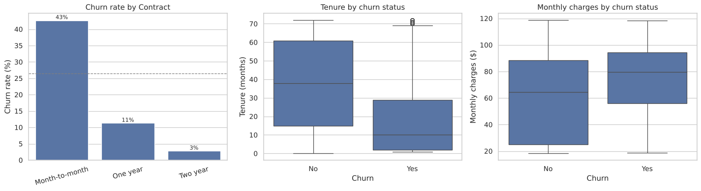
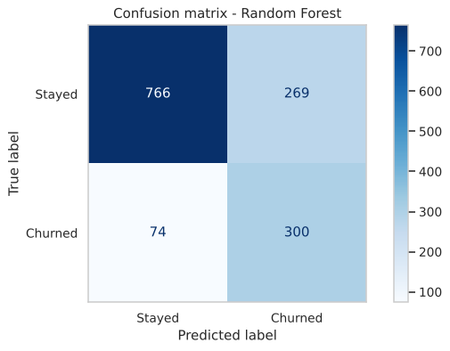
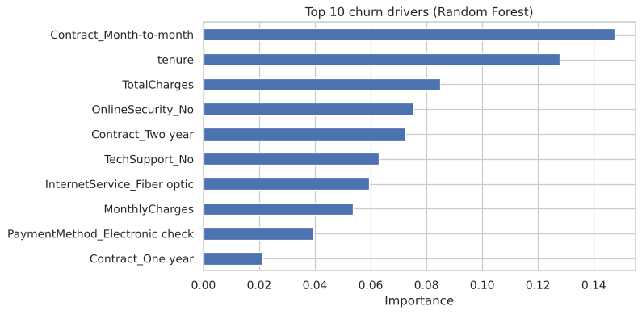

# Telco Customer Churn: Analysis & Prediction

Predicting which telecom customers are about to leave, and why, with Python, scikit-learn and a Streamlit app.

**Tools:** Python · pandas · scikit-learn · matplotlib / seaborn · Streamlit

## Business problem

About **26.5%** of this telecom company's customers churn. Winning a new customer costs far more than keeping an existing one, so the goal is to:

1. Find the customer and service traits most linked to churn
2. Build a model that flags at-risk customers early enough for the retention team to act

Because missing a churner is more expensive than sending an unneeded retention offer, the models are judged mainly on **recall and F1 for the churn class**, not plain accuracy.

## Key findings

| Driver | Churn rate |
|---|---|
| Month-to-month contract | **42.7%** (vs 11.3% one-year, 2.8% two-year) |
| Electronic check payment | **45.3%** (vs ~15–19% for other methods) |
| Fiber optic internet | **41.9%** (vs 19.0% DSL) |
| No tech support / no online security | **~42%** (vs ~15% with them) |
| New month-to-month customers (0–12 months) | **~51%** |

- Churners have a median tenure of **10 months**, against 38 for customers who stay.
- Churners pay more: a median of **\$80/month** against \$64.
- Gender has no effect on churn.



## Model results

Four models (Logistic Regression, Decision Tree, Random Forest, SVM) were trained inside a shared preprocessing pipeline, then tuned with 5-fold stratified cross-validation on churn F1. Adding **balanced class weights** was the biggest improvement.

| Model | Churn recall | Churn precision | Churn F1 | ROC AUC | Accuracy |
|---|---|---|---|---|---|
| **Random Forest (tuned), final model** | **0.80** | 0.53 | **0.64** | **0.84** | 0.76 |
| Logistic Regression (best untuned model) | 0.56 | 0.66 | 0.60 | 0.84 | 0.81 |

The final model catches **4 in 5 churners**, up from about 1 in 2. Accuracy falls slightly because it also flags some customers who would have stayed. For a retention campaign that trade-off is usually worth it.

| Confusion matrix | Top churn drivers |
|---|---|
|  |  |

## Recommendations

1. **Push contract upgrades:** offer month-to-month customers an incentive to move to one- or two-year plans.
2. **Focus on the first year:** onboarding and check-ins during the first 12 months, when churn is highest.
3. **Bundle protection services:** discounted Tech Support / Online Security for at-risk customers.
4. **Promote autopay:** move electronic-check payers to automatic bank or card payments.
5. **Review the fiber offer:** check its pricing and reliability.

## Streamlit app

`app.py` is an interactive churn predictor:

- **Prediction:** enter a customer's profile to get their churn probability, a risk level, and the risk factors that apply to them, each with a suggested action
- **Churn insights:** key numbers and churn-rate charts from the dataset
- **About the model:** test-set performance

## Run it locally

```bash
git clone https://github.com/manavramchand12-spec/Churn-ML.git
cd Churn-ML
pip install -r requirements.txt
streamlit run app.py
```

To retrain the model from scratch, run `python train.py`. The app also retrains automatically if the saved model can't be loaded on your scikit-learn version.

## Project structure

```
Churn-ML/
├── app.py                              # Streamlit app
├── train.py                            # Retrains and saves the final model
├── notebooks/
│   └── telco_churn_analysis.ipynb      # Full EDA, modelling and evaluation
├── data/
│   └── WA_Fn-UseC_-Telco-Customer-Churn.csv
├── models/
│   ├── churn_model.pkl                 # Trained pipeline (preprocessing + model)
│   └── metrics.json                    # Test-set metrics shown in the app
├── images/                             # Charts used in this README
└── requirements.txt
```

## Data

[IBM Telco Customer Churn](https://www.kaggle.com/datasets/blastchar/telco-customer-churn): 7,043 customers and 21 columns covering demographics, account details, services and whether the customer left in the last month.

---
**Manav Ramchand Novlani**, B.S. Data Science & Business Data Analytics, Arizona State University
